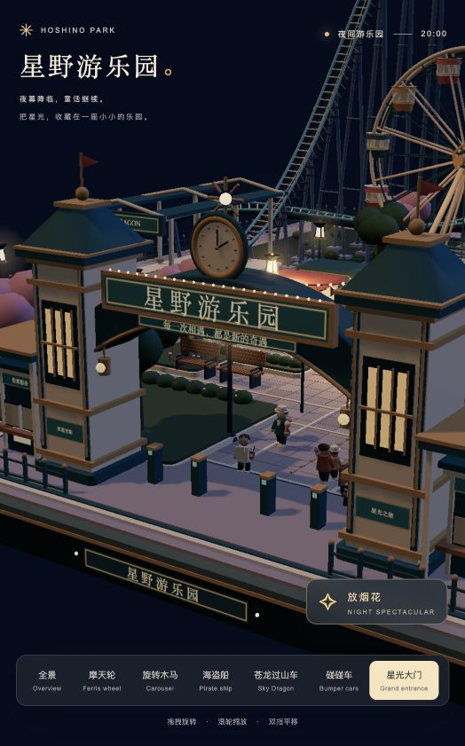

# 星野游乐园 · Hoshino Park

**把星光，收藏在一座小小的乐园。**

用 Three.js 构建的可交互三维微缩游乐园：夜色、暖灯、烟花、移动的游客，以及五种运转中的游乐设施。支持自由旋转、缩放和平移，从全景到近处观察模型细节。

当前版本：**v1.0.0 · 微缩园区展示版**。第一人称游玩是下一阶段，尚未开放。

<p align="center">
  
</p>

## 已实现的功能

| 设施 | 模型与运动 |
| --- | --- |
| 苍龙过山车 | 高约 25.6 场景单位、轨道长约 178 单位；六节列车、提升坡、陡降、驼峰和倾斜回转。平滑闭合双轨、慢速提升、快速下落与回站减速 |
| 摩天轮 | 12 个保持水平的座舱，持续缓慢转动 |
| 旋转木马 | 8 匹沿马头方向旋转、独立上下起伏的木马 |
| 海盗船 | 重力驱动的单摆运动：高处放慢、下落加速、最低点最快 |
| 碰碰车 | 8 辆车、约 13.1 × 11.2 单位的可行驶区域；惯性、保险杠碰撞、摩擦、侧撞偏转、回弹和乘客轻微前倾回正 |

尺寸采用场景单位，并非现实设施的工程尺寸；模型与物理用于视觉和交互展示。

园区包含：

- 48.5 × 48.5 的方形底座，默认夜景与柔和灯光。
- 双塔拱门、星光时钟、售票亭、游客服务亭及全中文招牌。
- 小吃摊、咖啡摊、自动贩卖机、喷泉、花坛、树木、长椅、灯串和导览牌。
- 17 位行走游客、2 位停留游客、39 位普通排队游客；部分游客携带饮料、冰淇淋或气球。
- 五组普通排队区和独立 VIP 通道，预留门禁、路线与登乘位置。
- 约 30 秒的烟花演出：升空光尾、花球、光环、爱心、金色垂柳及连发结尾，可结束或重播。
- 设施与入口特写、自动环绕、暂停设施、隐藏界面。

## 快速开始

需要支持 WebGL 的现代浏览器，以及 Node.js 18 或更新版本。**无需安装依赖，无需构建。**

```bash
git clone https://github.com/panding999/hoshino-park.git
cd hoshino-park
node server.mjs
```

打开 **http://127.0.0.1:4173/**，在终端按 `Ctrl+C` 停止服务。

也可运行 `npm start`，或用任意静态 HTTP 服务器提供 `dist/` 目录。请通过 HTTP 访问，不要直接双击 `index.html`，以免浏览器阻止 ES 模块加载。

Three.js、OrbitControls 和后处理依赖均固定版本并保存在仓库中；运行时不依赖外部模型、字体或纹理服务。

## 操作

| 操作 | 效果 |
| --- | --- |
| 鼠标左键拖拽 / 触屏单指拖拽 | 旋转场景 |
| 滚轮 / 双指缩放 | 拉近或拉远 |
| 鼠标右键拖拽 / 双指平移 | 移动观察中心 |
| 底部视角按钮 | 切换全景、设施、大门或排队区特写 |
| 暂停按钮 | 暂停设施和游客，烟花独立播放 |
| 环绕按钮 | 自动绕场景旋转 |
| `H` | 隐藏或恢复界面 |
| `Esc` | 恢复界面并返回全景 |
| 放烟花 | 开始或结束烟花演出 |

## 项目结构

```text
hoshino-park/
├── dist/
│   ├── index.html             # 页面与控件
│   ├── style.css              # 夜景界面与响应式布局
│   ├── main.js                # 场景、原有设施、游客、灯光和镜头
│   ├── expansion.js           # 过山车、碰碰车馆和排队区模型
│   ├── ride-motion.js         # 平滑轨道、列车速度、海盗船运动
│   ├── bumper-physics.js      # 碰碰车刚体模拟、NPC 驾驶、乘客回弹
│   ├── fireworks.js           # 烟花演出与粒子光尾
│   ├── ride-layout.json       # 入口、通道及登乘位置数据
│   └── vendor/               # Three.js r169、相关模块及许可证
├── docs/images/               # README 预览图
├── scripts/                   # 模型与运动验证脚本
├── server.mjs                 # 本地静态 HTTP 服务
├── package.json               # 启动、验证命令与 ES 模块配置
├── FIRST_PERSON_PLAN.md       # 第一人称交互与乘坐约定
└── README.md
```

模型由代码程序化生成。固定物件按材质合批；活动设施保留独立轴心。轨道采用曲率连续的闭合三次 B 样条，碰碰车和海盗船使用固定步长模拟，减少渲染帧率对行为的影响。

## 验证

```bash
npm test
```

或分别执行：

```bash
node scripts/verify-bumper-physics.mjs
node scripts/verify-ride-motion.mjs
```

- 碰碰车：正面碰撞、动量与能量、侧撞转矩、撞墙、暂停、车身重叠、场地边界、拥堵时间、乘客前倾及帧率独立性；包含八辆车连续 120 秒的模拟。
- 设施运动：轨道接点与倾斜角连续性、列车速度变化、海盗船最高/最低点速度和摆动稳定性。
- 运动验证同时调用扩建检查，验证入口、角色准入、轨道闭合与轨段间距，并重新生成 `dist/ride-layout.json`。

当前版本还在浏览器中检查了主要视角、动画、暂停、缩放和界面操作。视觉效果和性能仍会随设备与分辨率变化。

## 下一阶段：第一人称游玩

当前是可观赏的三维模型，**还不能在园内行走、实际登乘或手动驾驶碰碰车**。VIP 通道已有模型和角色规则，真实身份校验与门禁交互尚未接入。

- 园内行走、视角控制与场景碰撞。
- 普通游客排队，园主使用专属 VIP 入口。
- 玩家先入座，再由游客陆续登乘；除摩天轮外，由玩家按键启动。
- 乘坐结束后停稳、解锁离座，并恢复步行视角。

| 项目 | 计划的第一人称乘坐规则 |
| --- | --- |
| 摩天轮 | 持续慢转、玩家独享座舱，低位登乘，坐满一圈 |
| 过山车 | 手动启动，跑完整条轨道后回站 |
| 碰碰车 | 玩家驾驶、NPC 同场，运行一分钟后停车 |
| 旋转木马 | 手动启动，运行一分钟后减速停稳 |
| 海盗船 | 手动启动后缓慢起摆、逐渐荡高、再逐渐收摆；整轮约一分钟 |

完整约定见 [FIRST_PERSON_PLAN.md](FIRST_PERSON_PLAN.md)。以上是计划，不代表已经实现的功能。

## 参考与第三方依赖

夜间氛围参考[读卖乐园灯光](https://www.yomiuriland.com/jewellumination/enjoy/attraction/)；过山车造型参考 [Steel Dragon 2000](https://www.nagashima-onsen.co.jp/spaland/attraction/thrill/dragon.html) 与 [Fury 325](https://www.sixflags.com/carowinds/attractions/fury-325)。园区模型为程序化构建，未复制这些项目的模型或代码。

仓库包含 [Three.js r169](https://github.com/mrdoob/three.js/tree/r169) 及附属模块，采用 MIT 许可证；完整声明见 [dist/vendor/LICENSE](dist/vendor/LICENSE)。
